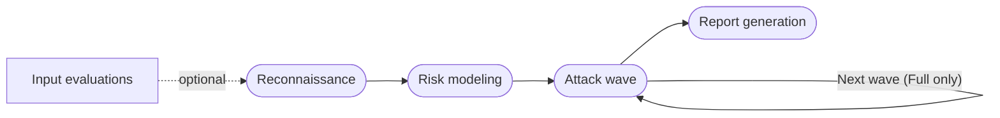

import { CardGrid, LinkCard } from "@astrojs/starlight/components";

An **Autonomous Agent Audit** tests your AI agent for security vulnerabilities, safety risks, and quality issues using autonomous red teaming agents. It explores how your agent behaves, builds a risk model for its use case, and runs targeted attacks to find weaknesses.

Use the results to understand how failures could affect your application, prioritize fixes, and build regression tests.

## What you get

- **AI Trust level**: An overall grade and assessment of your agent's behavior.
- **Risk model**: The risks identified for your agent and the scenarios tested.
- **Findings and recommendations**: Identified issues, supporting evidence, and proposed fixes.
- **Reusable tests**: Generated attack scenarios and results that you can review and use in evaluations.

Choose a **Light** audit for a prioritized subset of risk scenarios or a **Full** audit for all scenarios in the generated risk model across multiple attack waves.

## How an audit works

A Light audit runs one attack wave. A Full audit runs multiple waves.

:::tip[Audit or scan?]
An audit is more complete than a [vulnerability scan](/hub/ui/scan) because it maps your agent's attack surface, builds a risk model, and generates attacks that target those risks, all summed up in a report your whole organization can read. A scan instead runs a set of probes from the categories you select, and while its attacks still adapt to your agent, they don't follow a risk model. That said, scans finish in minutes, whereas audits take an hour or more.
:::

## Audit report

The PDF report brings together the priority findings, their severity, and the AI Trust assessment. [Download the report](/hub/ui/autonomous-agent-audit/review-audit-results#download-the-report) to share the results with your team.

## Get started

<CardGrid>
  <LinkCard
    title="Launch an audit"
    href="/hub/ui/autonomous-agent-audit/launch-audit"
    description="Choose your agent and audit effort, then follow the progress."
  />
  <LinkCard
    title="Review audit results"
    href="/hub/ui/autonomous-agent-audit/review-audit-results"
    description="Investigate findings, prioritize fixes, and build regression tests."
  />
</CardGrid>
